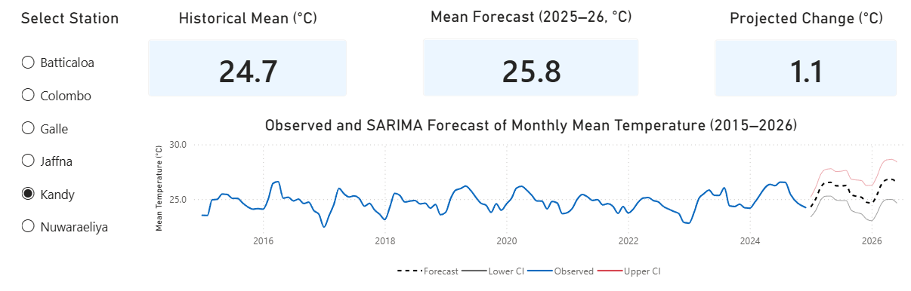
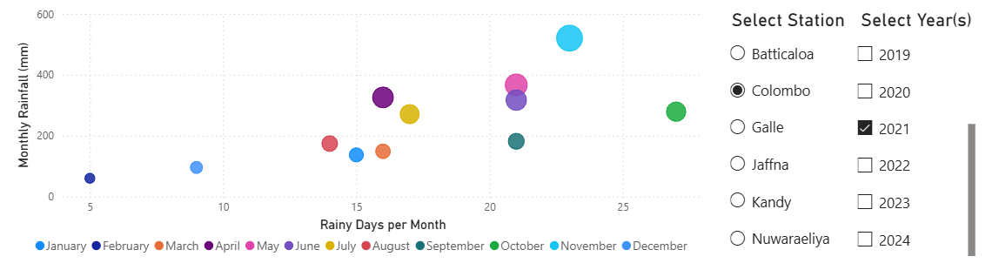
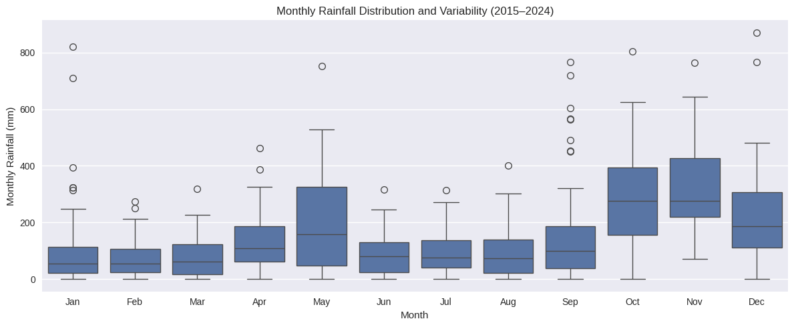
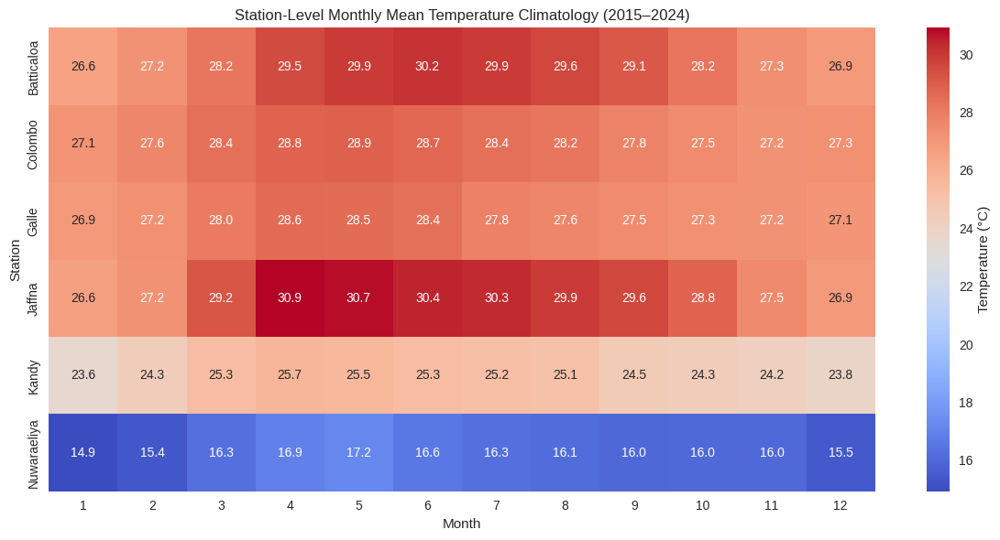

# 🌦️ Climate Time-Series Forecasting & Power BI Analytics

An end to end **climate analytics and decision-support project** combining Python based data processing, statistical time-series forecasting, and interactive Power BI dashboards for Sri Lankan meteorological data.

The project uses **NOAA Global Surface Summary of the Day (GSOD)** observations from **2015–2024** to explore climate patterns and generate short term temperature forecasts using **SARIMA** models.

## 🎯 Project Overview

Climate datasets contain strong seasonal patterns, spatial variability, and missing observations, making them difficult to interpret directly.

This project develops an integrated analytical workflow that combines:

- Python based data preprocessing and transformation
- Exploratory and seasonal climate analysis
- Station level and spatial comparisons
- Rainfall variability and extreme-event analysis
- SARIMA time-series forecasting
- Hold-out forecast validation
- Temperature projections with 95% confidence intervals
- Interactive Power BI dashboards for decision support

The objective is to bridge **statistical forecasting** and **interactive Business Intelligence**.

## 🧩 Analytical Workflow

```text
NOAA GSOD Data
       ↓
Python Preprocessing
(Cleaning, Unit Conversion, Aggregation)
       ↓
Exploratory & Seasonal Analysis
       ↓
SARIMA Modeling & Validation
       ↓
Forecast Outputs
       ↓
Interactive Power BI Dashboards
```

## 📂 Dataset

**Study period:** January 2015 – December 2024

Six Sri Lankan meteorological stations were analyzed:

- Batticaloa
- Colombo
- Galle
- Jaffna
- Kandy
- Nuwara Eliya

Daily observations were cleaned, converted to metric units, and aggregated to monthly resolution.

## 🔬 Methodology

### 🐍 Data Preprocessing

Python and Pandas were used for cleaning, unit conversion, missing-value handling, and monthly aggregation.

### 📈 SARIMA Forecasting

SARIMA models were developed at national and individual station levels, using a seasonal period of **12 months**.

### ✅ Model Validation

| Dataset    | Period                       |
| ---------- | ---------------------------- |
| Training   | January 2015 – December 2022 |
| Validation | January 2023 – December 2024 |
| Forecast   | January 2025 – June 2026     |

Performance was evaluated using **RMSE** and **MAE**.

## 📊 Results & Dashboard Highlights

### 🔮 Observed & SARIMA-Based Temperature Projections (2015–2026)

The models generate temperature projections through **June 2026** with **95% confidence intervals**. The Power BI dashboard enables interactive station selection and comparison of historical observations, forecast trajectories, and uncertainty bounds.



#### 🏆 National Forecast Performance

| Metric   |       Result |
| -------- | -----------: |
| **RMSE** | **0.832 °C** |
| **MAE**  | **0.748 °C** |

#### 📍 Station-Level Forecast Performance

| Station      | RMSE (°C) | MAE (°C) |
| ------------ | --------: | -------: |
| Batticaloa   |     1.235 |    0.878 |
| Colombo      |     0.526 |    0.396 |
| Galle        |     0.839 |    0.703 |
| Jaffna       |     1.167 |    0.800 |
| Kandy        |     1.620 |    1.465 |
| Nuwara Eliya |     0.952 |    0.758 |

### 🌧️ Rainfall Variability & Extremes

The interactive Power BI visualization explores the relationship between **rainy days per month** and **total monthly rainfall**.



#### Monthly Rainfall Distribution



Rainfall shows substantial variability, particularly during the late monsoon period, with October and November showing higher dispersion and several extreme observations.

### 🌡️ Station-Level Temperature Climatology



Monthly climatology reveals clear seasonal and geographic differences. Coastal stations generally remain warmer, while high-elevation **Nuwara Eliya** shows substantially lower temperatures.

## 📊 Power BI Decision-Support Dashboard

The processed datasets and forecasting outputs were integrated into **Microsoft Power BI**.

The dashboards support:

- Temperature trend exploration
- Station-level and spatial analysis
- Rainfall variability analysis
- Year and station filtering
- Historical vs forecast temperature comparison
- Forecast trajectories
- 95% confidence interval visualization

The complete Power BI project is included as:

`📁 sri_lanka_climate_forecasting.pbix`

> **Note:** The dashboard is not currently hosted publicly. The `.pbix` file can be opened using Microsoft Power BI Desktop. Key dashboard views and analytical results are presented above.

## 💡 Key Findings

- Strong annual temperature seasonality across Sri Lankan stations.
- Clear geographic and altitudinal differences in temperature.
- Coastal stations generally show higher temperatures than high-elevation locations.
- Nuwara Eliya maintains substantially lower mean temperatures due to elevation.
- Rainfall shows considerably greater variability than temperature.
- Rainfall dispersion increases during late monsoon months, particularly October and November.
- SARIMA captures the recurring seasonal structure of monthly temperature data.
- Forecast accuracy varies across stations, reflecting localized climatic characteristics.

## 🛠️ Technologies & Skills

`Python` • `Pandas` • `Statsmodels` • `SARIMA` • `Time-Series Analysis` • `Forecasting` • `Data Preprocessing` • `Exploratory Data Analysis` • `Power BI` • `Business Intelligence` • `Data Visualization` • `Climate Analytics` • `NOAA GSOD`

---

⭐ If you find this project useful or interesting, consider starring the repository.
